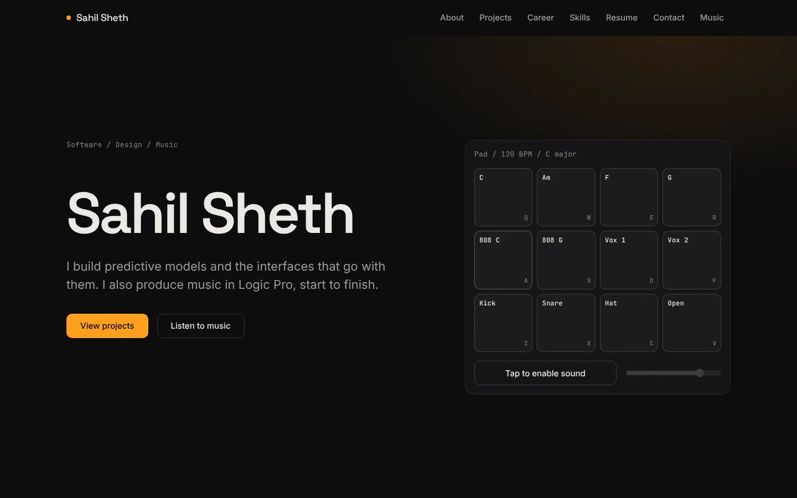
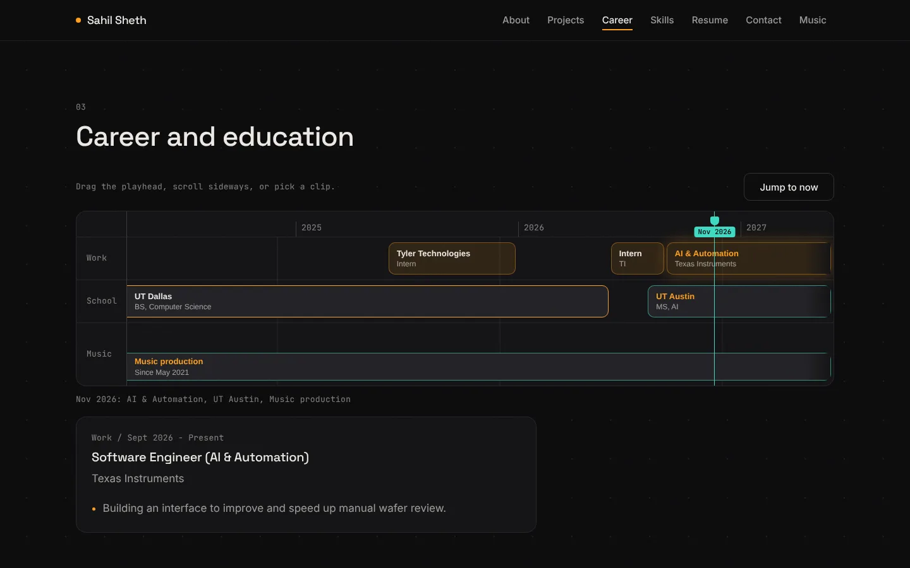
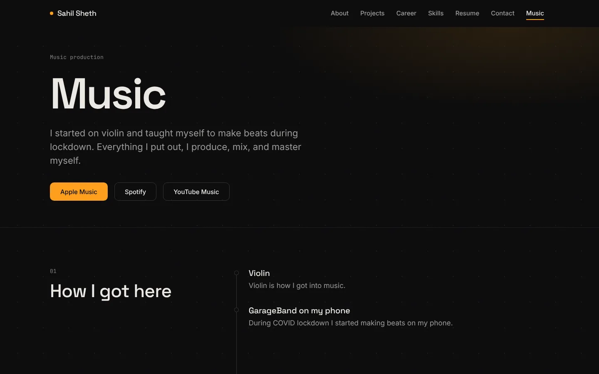
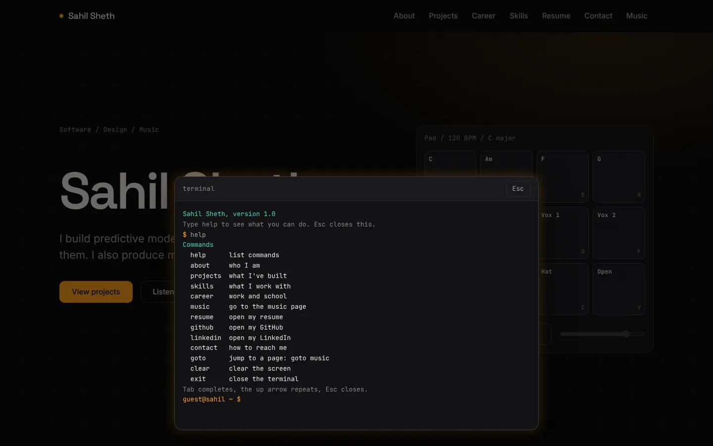
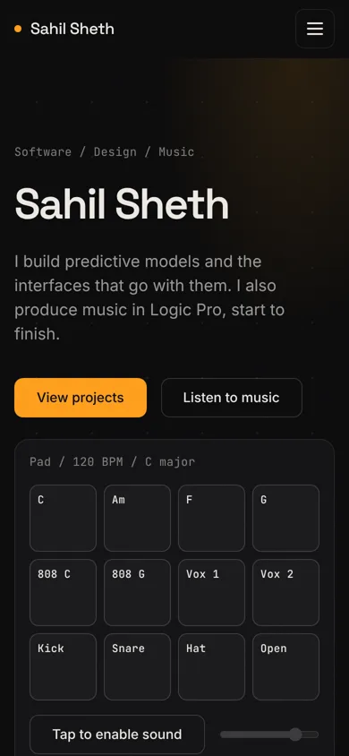

# Sahil Sheth: portfolio

My personal site: software and design with an AI/ML focus, plus music production. It is built to feel like a studio: dark, layered, with a playable pad in the hero, a career timeline laid out like a DAW, and a music page with a live audio visualizer.

**Live site:** https://sahilsheth1.github.io



| Career timeline                                  | Music page                                 |
| ------------------------------------------------ | ------------------------------------------ |
|  |  |

| Hidden terminal (press `` ` ``)             | On a phone                              |
| ------------------------------------------- | --------------------------------------- |
|  |  |

## What is in it

- **Hero pad.** Twelve pads you can play with the mouse, touch, or the keyboard (Q W E R, A S D F, Z X C V), in 120 BPM and C major. Sound is off until you turn it on.
- **Career timeline.** Work, school, and music laid out as lanes on a timeline with a playhead. Music releases are pulled from Apple Music at build time, and a daily rebuild keeps them current. Every detail is also available as a plain list.
- **Music page.** My story, a featured track with a visualizer, Spotify and Apple Music players, and a full release list.
- **Cursor-reactive background.** A quiet dot grid that moves away from the cursor and brightens with the music.
- **Hidden terminal.** Press `` ` `` or Ctrl/Cmd+K, or use the `>_` button in the footer. Try `help`.

Everything important works without any of these. Reduced-motion settings are respected and nothing plays on its own.

## Built with

Astro (static output), plain CSS with design tokens, Lenis and GSAP for motion, the Web Audio API and Canvas 2D for sound and visuals, self-hosted fonts (Space Grotesk, Inter, JetBrains Mono), GitHub Actions and GitHub Pages for deployment. Prettier and ESLint keep the code tidy.

## Run it locally

You need Node 22.23 or newer and Git.

```bash
git clone https://github.com/SahilSheth1/SahilSheth1.github.io.git
cd SahilSheth1.github.io
npm install
npm run dev        # http://localhost:4321
```

Other commands:

```bash
npm run build      # build to dist/
npm run preview    # serve the built site
npm run format     # Prettier
npm run lint       # ESLint
```

## Editing content

All copy and settings live in `src/data/`, so pages never need touching for text changes.

| File          | What it controls                                     |
| ------------- | ---------------------------------------------------- |
| `content.js`  | About, projects, career, education, skills           |
| `site.js`     | Name, links, nav, resume path, Apple Music artist id |
| `music.js`    | Music page story, profile links, featured track      |
| `pad.js`      | The twelve pads and their sounds                     |
| `terminal.js` | Terminal welcome text and easter eggs                |

The resume is `public/Resume.pdf`. Pad sounds and the featured song go in `public/audio/`.

## Deploying

Pushing to `main` builds and publishes the site with GitHub Actions (`.github/workflows/deploy.yml`). The same workflow also runs once a day so new Apple Music releases show up without a code change.

## How it is organised

```
src/
  components/   page pieces (nav, footer, pad, visualizer, terminal, sections)
  data/         all content and settings
  layouts/      the shared page shell
  pages/        home, music, 404
  scripts/      pad, audio, timeline, background, terminal, links
  styles/       design tokens, base styles, motion
public/         static files: audio, resume, icons, share image
docs/           screenshots used by this README
```

## Working notes

`PLAN.md` is the build plan, `PROJECT_NOTES.md` the decision log, and `DESIGN_SPEC.md` the design system.
